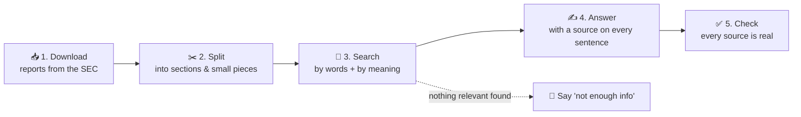
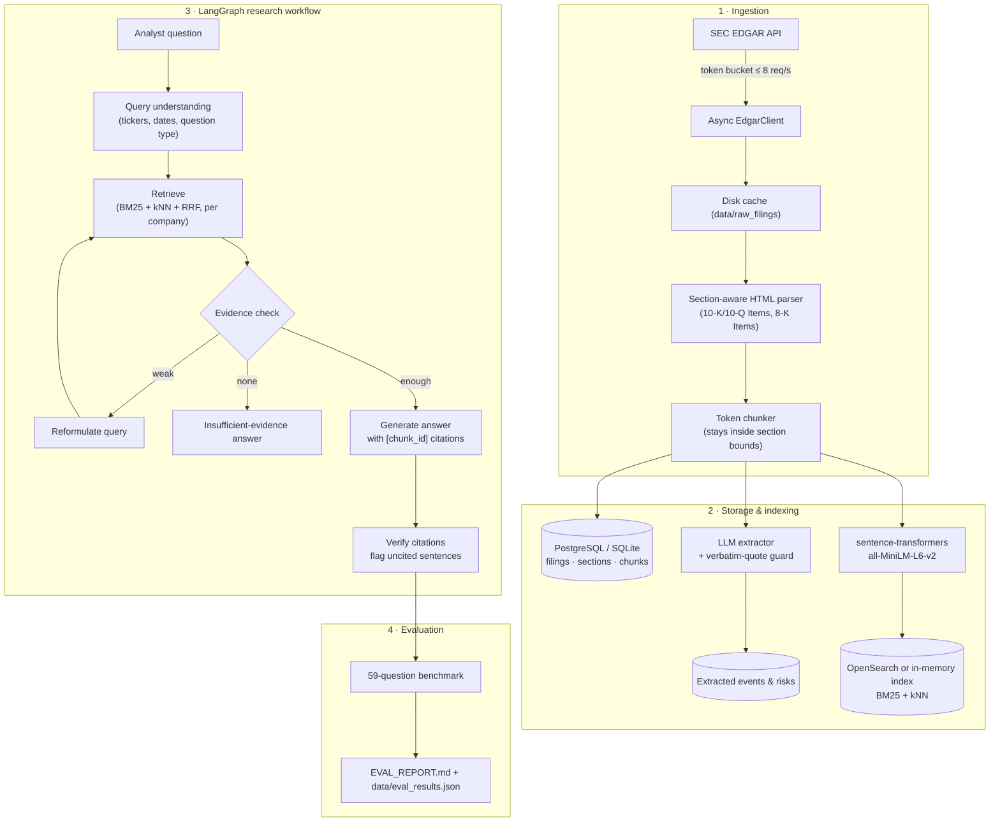
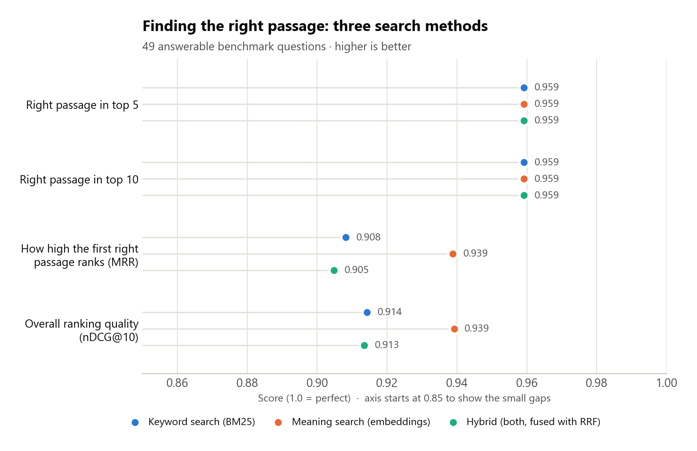

<div align="center">

# AlphaLens

**Ask questions about company reports. Get answers with proof.**

[](https://www.python.org/downloads/)
[](https://fastapi.tiangolo.com)
[](https://github.com/langchain-ai/langgraph)
[](#-run-it-yourself)


<sub>▶ 50-second explainer · <a href="assets/explainer.mp4">download the sharper MP4</a></sub>

</div>

---

## 🧭 What is this, in plain words?

Every public company in the US has to publish long reports with the government (the **SEC**). They explain how the business is doing, how much money it made, and what could go wrong. Each report can run to **hundreds of pages**, and investors have to read stacks of them.

**AlphaLens reads those reports for you.** You type a question in normal English, like:

> *"How did Apple's Services revenue change in 2023?"*
> *"Compare the AI risks Microsoft and Amazon warn about."*

AlphaLens finds the exact paragraphs that answer it and writes a short answer. **Every sentence points to where it came from**, so you can check it yourself. If the reports don't contain the answer, it says so instead of making something up.

Think of it as a very careful research assistant. It always shows its sources and never guesses.

### Who is it for?

- **Investment analysts** who need facts from filings quickly and need to trust them.
- **Students and learners** who want to see how a real RAG system (*Retrieval-Augmented Generation*: search first, then write) is built, tested, and measured.

---

## ⚙️ How it works: five steps



| Step | What happens (simple version) | Where in the code |
| :--- | :--- | :--- |
| **1. Download** | Fetches 10-K, 10-Q and 8-K reports from the SEC's free [EDGAR](https://www.sec.gov/edgar) site, staying under the SEC's speed limit (≤ 8 requests per second) and saving copies locally. | [`src/edgar/client.py`](src/edgar/client.py) |
| **2. Split** | Finds the report's sections (e.g. *Item 1A Risk Factors*, *Item 7 Management's Discussion*) and cuts each one into small pieces of about 400 tokens (a few paragraphs). A piece never mixes two sections. | [`src/edgar/parser.py`](src/edgar/parser.py), [`src/edgar/chunker.py`](src/edgar/chunker.py) |
| **3. Search** | Looks for pieces two ways: **by exact words** (BM25) and **by meaning** (a small AI model turns text into numbers). It then merges both lists (RRF). For "compare A and B" questions, it searches each company separately so the bigger one doesn't drown out the other. | [`src/retrieval/`](src/retrieval/) |
| **4. Answer** | An AI model (Claude, or a free offline stand-in) writes the answer and tags each sentence with the piece it used, like `[chunk_id]`. | [`src/workflow/graph.py`](src/workflow/graph.py) |
| **5. Check** | A checker confirms every tag points to a piece that was actually found and flags sentences with no source. If search found nothing useful, the system first retries with a looser search, then says *"not enough information."* | [`src/workflow/graph.py`](src/workflow/graph.py) |

**Bonus: fact extraction with a "no made-up quotes" rule.** AlphaLens can also pull out structured facts such as events, deals, and risks. Each fact must come with a quote, and if that quote isn't found **word-for-word** in the report, the fact is thrown away. See [`src/extraction/extractor.py`](src/extraction/extractor.py).

<details>
<summary><b>Show the detailed technical diagram</b></summary>



</details>

---

## 🏢 What it covers

**10 companies across 3 sectors** (configured in [`config/companies.yaml`](config/companies.yaml)):

| Technology | Financials & Healthcare | Consumer, Energy & Auto |
| :--- | :--- | :--- |
| Apple (AAPL) · Microsoft (MSFT) · NVIDIA (NVDA) · Amazon (AMZN) · Meta (META) | JPMorgan Chase (JPM) · Pfizer (PFE) | Tesla (TSLA) · Walmart (WMT) · Exxon Mobil (XOM) |

**3 kinds of reports:**

| Report | What it is | Coverage |
| :--- | :--- | :--- |
| **10-K** | The big yearly report | last 3 years |
| **10-Q** | The quarterly update | last 6 quarters |
| **8-K** | "Something important just happened" (earnings, CEO change, big deal) | last 12 months |

---

## 📊 Results

AlphaLens is tested on **59 hand-checked questions** of five kinds, including 10 trick questions that *can't* be answered from the reports.

<p align="center">
  <picture>
    <source media="(prefers-color-scheme: dark)" srcset="assets/question_mix_dark.png">
    
  </picture>
</p>

### 1. Does it find the right paragraph?

<p align="center">
  <picture>
    <source media="(prefers-color-scheme: dark)" srcset="assets/retrieval_benchmark_dark.png">
    
  </picture>
</p>

**In plain words:** for about **96 out of 100** answerable questions, the right paragraph shows up in the first 5 results, whichever search method is used. *Meaning search* puts it nearest the top most often.

| Search method | Found in top 5 (Recall@5) | Found in top 10 (Recall@10) | How high it ranks (MRR) | Ranking quality (nDCG@10) |
| :--- | :---: | :---: | :---: | :---: |
| Keyword (BM25) | 0.959 | 0.959 | 0.908 | 0.914 |
| **Meaning (embeddings)** | 0.959 | 0.959 | **0.939** | **0.939** |
| Hybrid (BM25 + embeddings, RRF) | 0.959 | 0.959 | 0.905 | 0.913 |

### 2. Can you trust the answers?

<p align="center">
  <picture>
    <source media="(prefers-color-scheme: dark)" srcset="assets/answer_quality_dark.png">
    
  </picture>
</p>

| What we measured | Score | Plain meaning |
| :--- | :---: | :--- |
| Correct "not enough info" | **100%** | All 10 trick questions were correctly declined. |
| Citation support | **96.6%** | When a sentence cites a source, that source really says it. |
| Factual grounding | **81.2%** | Share of sentences backed by the paragraphs that were found. |
| Citation coverage | **60.1%** | Share of factual sentences that carry a citation. **This is the weakest spot.** |
| Speed | **31 ms** typical (p50), 32 ms slow-end (p95) | Measured with the free offline answer writer, not a live AI model. |
| Cost | **$0** per question | Offline mode makes no paid API calls. |

**Is the automatic grader any good?** We compared it against a person on 20 hand-labeled examples ([`data/hand_labeled_grounding_sample.json`](data/hand_labeled_grounding_sample.json)). They agreed on **15 of 20 (75%)**, with Cohen's kappa of **0.50**, which counts as *moderate* agreement. So read the grounding scores as a useful signal, not exact truth.

### 3. Where does it go wrong?

<p align="center">
  <picture>
    <source media="(prefers-color-scheme: dark)" srcset="assets/failure_breakdown_dark.png">
    
  </picture>
</p>

Search is rarely the problem (4 misses). Most mistakes happen **after** the right facts are found: comparing them badly (26), or writing a sentence without a citation (10). That tells us where to improve next: the answer-writing step, not the search.

---

## 🔍 Honest notes: what these numbers do and don't mean

Read these before quoting the numbers above.

- **The test text is a small practice set, not the full SEC archive.** The benchmark runs on a hand-written collection of filing-style paragraphs, plus look-alike "distractor" companies (AMD, BAC, GOOGL, RIVN, CVX) to make search harder. See `generate_hardened_evaluation_corpus` in [`src/eval/runner.py`](src/eval/runner.py). Real filings are messier, so expect lower scores on them.
- **Answers in the benchmark come from the free offline writer, not Claude.** The answer-quality and speed numbers test the pipeline (search → cite → check), not the writing quality of a real AI model. Set `LLM_PROVIDER=claude` with an API key and re-run `make eval` to measure that.
- **Some experiments aren't measured yet.** The "prompt v1 vs v2" and "Haiku vs Sonnet" rows in [`data/eval_results.json`](data/eval_results.json) are fixed values typed into the runner, not live measurements, so they're left out here.
- **The chunk-size experiment showed no difference.** The practice paragraphs are short, so 256, 512 and 1024-token settings all produced the same 25 pieces and the same perfect score.
- **The ticker-filter experiment needs a fix.** With the company filter on, precision@5 came out *lower* (0.21 vs 0.95). The likely cause: the "is this a hit?" check matches by section name and keywords, not company, so another company's paragraph counts as correct when the filter is off.
- **"Extraction errors = 0" isn't a result.** The grader never assigns that category, so it's left out of the failure chart.

---

## 🚀 Run it yourself

**You need:** Python 3.11+ and Git. Docker is optional (for the full Postgres + OpenSearch setup).

```bash
# 1. Get the code
git clone https://github.com/samruddhichitnis02/alphalens.git
cd alphalens

# 2. Create a virtual environment
python -m venv .venv
source .venv/bin/activate          # Windows: .venv\Scripts\Activate.ps1

# 3. Install
pip install uv
uv pip install -e .

# 4. Settings: the SEC requires a name + email in your User-Agent
cp .env.example .env               # then edit SEC_USER_AGENT
```

| Command | What it does |
| :--- | :--- |
| `make test` | Runs the unit tests (`pytest tests/ -v`). |
| `make eval` | Runs the full 59-question benchmark, rewrites [`EVAL_REPORT.md`](EVAL_REPORT.md) and [`data/eval_results.json`](data/eval_results.json). |
| `make review` | Opens a small terminal tool to review benchmark questions by hand. |
| `make run` | Starts the API at <http://localhost:8000> (interactive docs at `/docs`). |
| `make up` / `make down` | Starts / stops PostgreSQL 16 + OpenSearch 2.13 in Docker. |

> 💡 **No API key? No problem.** With `LLM_PROVIDER=mock`, everything (embeddings, search, answers) runs on your machine for free.

**Refresh the charts and video** after a new `make eval`:

```bash
python scripts/generate_charts.py            # reads data/eval_results.json → assets/*.png
pip install imageio imageio-ffmpeg           # only needed for the MP4
python scripts/generate_explainer_video.py   # → assets/explainer.gif + .mp4
```

---

## 🔌 API

| Method | Endpoint | What it does |
| :--- | :--- | :--- |
| `POST` | `/api/v1/ingest/{ticker}` | Download, split and index the filings for one company. |
| `GET` | `/api/v1/filings` | List the filings indexed so far. |
| `GET` | `/api/v1/filings/{id}/sections` | Show the sections found in one filing. |
| `POST` | `/api/v1/ask` | Ask a question; get an answer with citations. |

```bash
curl -X POST http://localhost:8000/api/v1/ask \
  -H "Content-Type: application/json" \
  -d '{"query": "Compare Microsoft Azure and Amazon AWS cloud growth", "retrieval_method": "hybrid", "top_k": 5}'
```

---

## 🗂️ Project layout

```
alphalens/
├── src/
│   ├── edgar/        # 1–2 · download, parse sections, chunk
│   ├── retrieval/    # 3   · BM25, embeddings, hybrid RRF (local or OpenSearch)
│   ├── workflow/     # 4–5 · LangGraph: understand → retrieve → check → answer → verify
│   ├── extraction/   #       structured facts with the verbatim-quote guard
│   ├── eval/         #       benchmark, metrics, grounding judge, review CLI
│   ├── api/          #       FastAPI routes
│   └── db/           #       SQLAlchemy models (Postgres / SQLite)
├── config/companies.yaml   # the 10 companies covered
├── data/                   # benchmark questions, eval results, hand-labeled sample
├── scripts/                # chart + explainer-video generators
├── tests/                  # pytest suite
└── EVAL_REPORT.md          # auto-generated by `make eval`
```

---

## 📖 Mini-glossary

| Term | Simple meaning |
| :--- | :--- |
| **SEC / EDGAR** | The US regulator / its free public website of company filings. |
| **RAG** | *Retrieval-Augmented Generation*: search for facts first, then write the answer from them. |
| **Chunk** | One small piece of a report (a few paragraphs). |
| **BM25** | Classic keyword search: scores pieces by matching words. |
| **Embeddings** | Turning text into numbers so similar *meanings* land close together. |
| **RRF** | *Reciprocal Rank Fusion*: a simple way to merge two ranked lists into one. |
| **Recall@k** | "Was a right answer somewhere in the top *k* results?" |
| **MRR** | "How close to the top was the first right answer?" (1.0 = always first.) |
| **nDCG@10** | Overall ranking quality of the top 10, rewarding right answers near the top. |
| **Abstention** | Choosing to say "I don't know" instead of guessing. |
| **Cohen's kappa** | Agreement between two graders, corrected for lucky guesses (0 = chance, 1 = perfect). |
