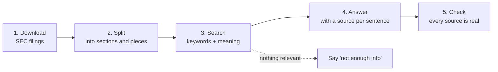
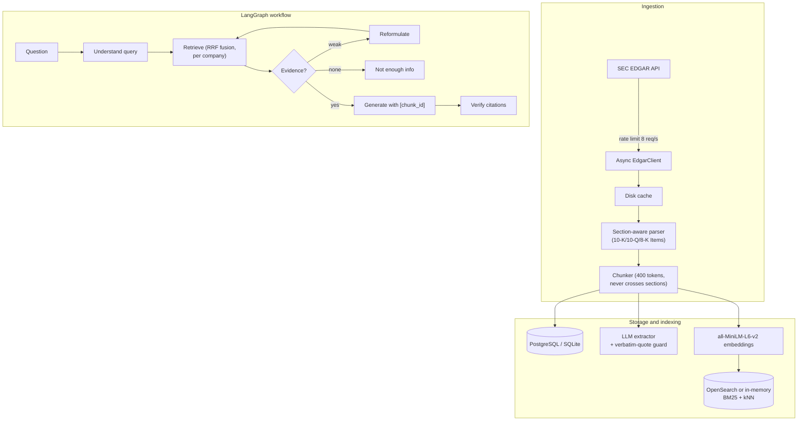
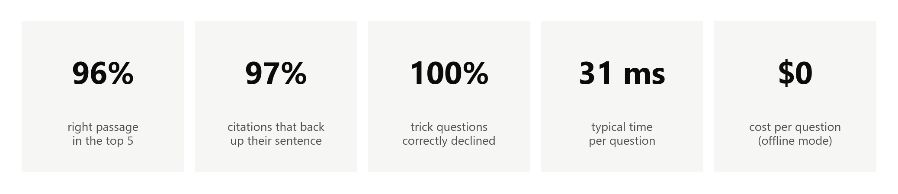
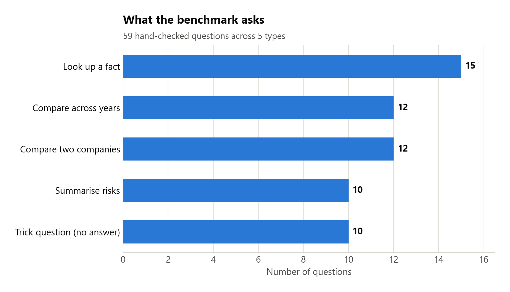
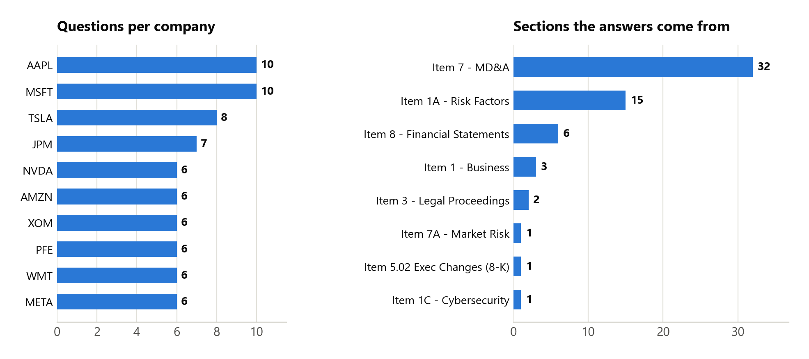
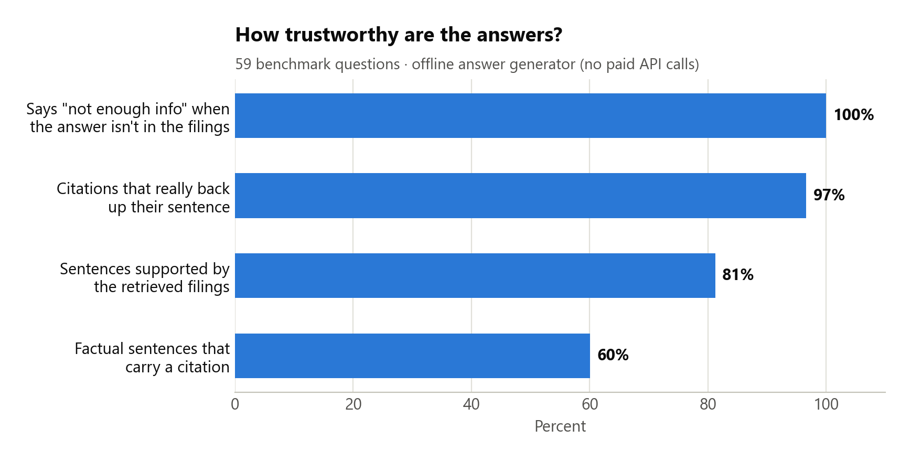
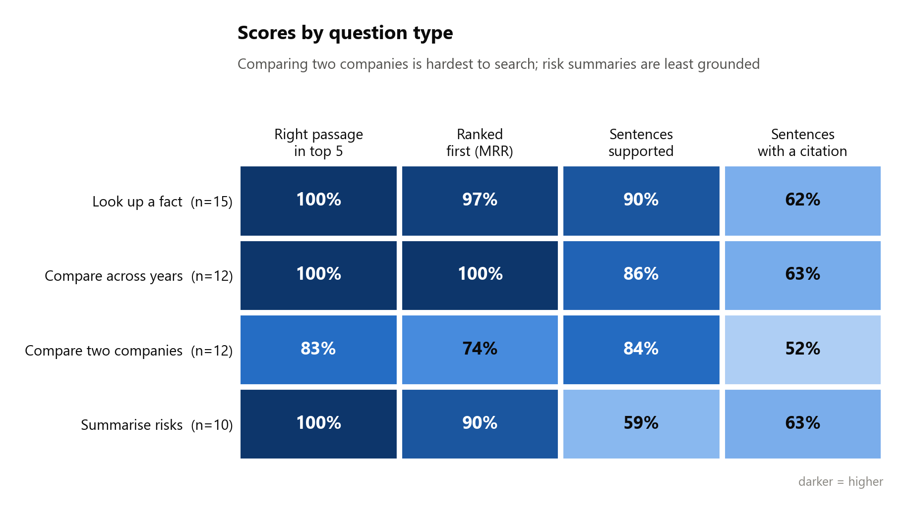
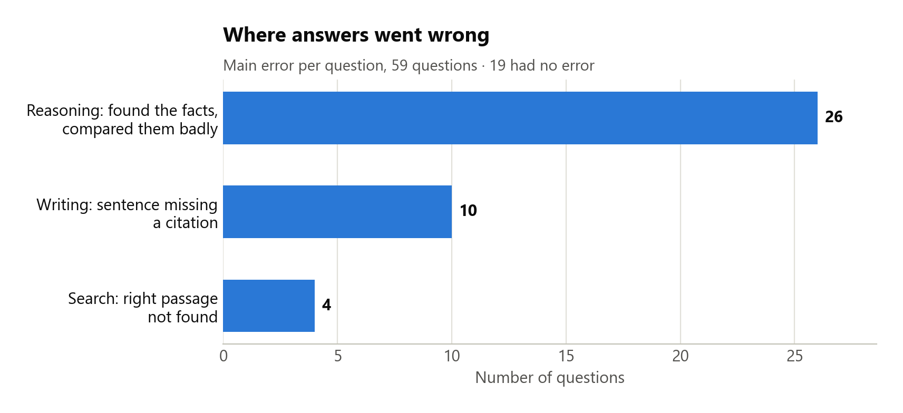
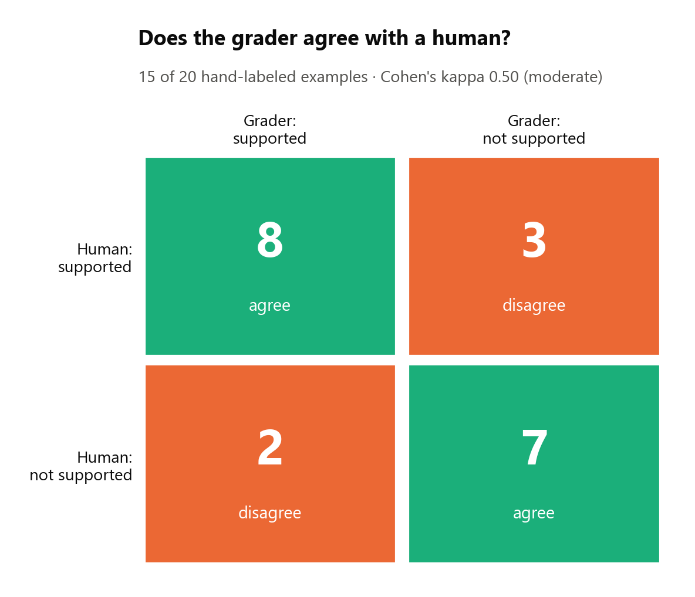

<div align="center">

# AlphaLens

**Ask questions about company reports. Get answers with proof.**

[](https://www.python.org/downloads/)
[](https://fastapi.tiangolo.com)
[](https://github.com/langchain-ai/langgraph)
[](#run-it-yourself)


<sub>50-second explainer · <a href="assets/explainer.mp4">download the MP4</a></sub>

</div>

## What it does

Public companies publish long reports with the SEC: yearly (10-K), quarterly (10-Q) and big-news (8-K) filings, often hundreds of pages each. AlphaLens searches them, answers your question in plain English, and **tags every sentence with the paragraph it came from**. If the reports don't contain the answer, it says so.

**Example of the answer format:**

> **Q:** How did Apple's Services revenue change in 2023?
>
> **A:** Services net sales reached a record $85.2 billion, up 9%, driven by advertising, cloud services and the App Store `[AAPL 10-K, Item 7]`.
>
> **Q:** What will Apple's stock price be next year?
>
> **A:** The filings don't contain enough information to answer that.

### Why it matters

AI chatbots can sound confident while being wrong. In finance, a made-up number can lead to a bad decision. AlphaLens is built so that **every claim can be traced back to the original report**, and it is measured on how often it gets that right.

### Key features

- **Reads the report the way it's organized.** It splits filings by their official sections (Risk Factors, Management's Discussion, Financial Statements) instead of cutting at random points.
- **Searches two ways at once.** It matches exact words (like "Azure") and similar meaning (like "cloud revenue"), then merges the two lists.
- **Fair comparisons.** When you ask about two companies, it searches each one separately so the bigger company doesn't crowd out the smaller one.
- **No made-up quotes.** Any extracted fact whose quote isn't found word-for-word in the filing is thrown away.
- **Free to run.** It works fully offline with a local search model. Claude can be switched on for better answers.

## How it works

Each question goes through five steps. If search finds nothing useful, it tries once more with a looser search, then answers "not enough info" instead of guessing.



<details>
<summary>Detailed architecture</summary>



</details>

## Results at a glance

AlphaLens was tested on 59 questions with known correct answers. Here are the headline numbers. The sections below break them down.

<picture>
  <source media="(prefers-color-scheme: dark)" srcset="assets/kpis_dark.png">
  
</picture>

### The benchmark: 59 hand-checked questions

The questions cover five kinds of tasks, from simple fact lookups to comparisons. They also include 10 trick questions that the reports can't answer, which test whether the system admits it doesn't know.

<picture>
  <source media="(prefers-color-scheme: dark)" srcset="assets/question_mix_dark.png">
  
</picture>

<picture>
  <source media="(prefers-color-scheme: dark)" srcset="assets/benchmark_coverage_dark.png">
  
</picture>

All 10 companies are covered. Most answers live in *Management's Discussion & Analysis* (Item 7), where companies explain their results in their own words.

### Search: does it find the right paragraph?

A good answer starts with finding the right paragraph. We compared three search methods: keyword search, meaning search, and a hybrid of both.

<picture>
  <source media="(prefers-color-scheme: dark)" srcset="assets/retrieval_benchmark_dark.png">
  
</picture>

All three find the right paragraph in the top 5 results for about 96% of questions. Meaning search does slightly better at putting it in **first place**.

### Answers: can you trust them?

<picture>
  <source media="(prefers-color-scheme: dark)" srcset="assets/answer_quality_dark.png">
  
</picture>

When AlphaLens cites a source, the source almost always backs up the sentence (97%), and it never answered a trick question. The weak spot is that only 60% of factual sentences carry a citation at all. That's the next thing to improve.

The grid below shows the same scores split by question type:

<picture>
  <source media="(prefers-color-scheme: dark)" srcset="assets/scores_by_type_dark.png">
  
</picture>

Simple lookups and year-over-year comparisons do best. Comparing two companies is hardest, because the system has to find and combine evidence from two different reports.

### Errors: where does it go wrong?

<picture>
  <source media="(prefers-color-scheme: dark)" srcset="assets/failure_breakdown_dark.png">
  
</picture>

Search is rarely the problem: only 4 misses. Most errors happen **after** the right facts are found, when the answer compares them poorly or leaves out a citation. So the next improvements should go into the answer-writing step, not search.

### Grader check: does the automatic grader match a human?

The scores above come from an automatic grader. To check the grader itself, a person labeled 20 examples by hand and we compared their labels with the grader's.

<picture>
  <source media="(prefers-color-scheme: dark)" srcset="assets/judge_agreement_dark.png">
  
</picture>

They agree 15 times out of 20. That's good enough to show trends, but not exact, so treat the answer scores as a guide.

<details>
<summary>Limits of these numbers</summary>

- The benchmark uses a small hand-written set of filing-style paragraphs (`generate_hardened_evaluation_corpus` in [`src/eval/runner.py`](src/eval/runner.py)), not the full SEC archive.
- Answers come from the free offline generator, not Claude. Set `LLM_PROVIDER=claude` and re-run `make eval` to measure a real model.
- The prompt-version and model-tier rows in `eval_results.json` are fixed values, not measurements, so they're not shown.
- The ticker-filter ablation lowers precision (0.95 to 0.21) because the hit check matches on section and keywords, not company. This needs a fix.
- The grader never assigns `extraction_error`, so that category is left out.

</details>

## Coverage

| Sector | Companies |
| :--- | :--- |
| Technology | AAPL, MSFT, NVDA, AMZN, META |
| Financials & Healthcare | JPM, PFE |
| Consumer, Energy & Auto | TSLA, WMT, XOM |

Filings: 10-K (last 3 years), 10-Q (last 6 quarters), 8-K (last 12 months). Configured in [`config/companies.yaml`](config/companies.yaml).

## Run it yourself

```bash
git clone https://github.com/samruddhichitnis02/alphalens.git
cd alphalens
python -m venv .venv
source .venv/bin/activate          # Windows: .venv\Scripts\Activate.ps1
pip install uv && uv pip install -e .
cp .env.example .env               # set SEC_USER_AGENT (name + email, required by the SEC)
```

| Command | What it does |
| :--- | :--- |
| `make test` | Run the unit tests |
| `make eval` | Run the 59-question benchmark |
| `make run` | Start the API at http://localhost:8000 (docs at `/docs`) |
| `make up` / `make down` | Start / stop PostgreSQL + OpenSearch in Docker |

Without Docker, set `DATABASE_URL` to the SQLite line in `.env.example` and `LLM_PROVIDER=mock`. Everything then runs locally for free.

Refresh the charts and video after `make eval`:

```bash
python scripts/eval_breakdown.py            # per-question-type numbers
python scripts/generate_charts.py           # all charts in assets/
python scripts/generate_explainer_video.py  # explainer GIF + MP4 (MP4 needs imageio-ffmpeg)
```

## API

| Method | Endpoint | Purpose |
| :--- | :--- | :--- |
| `POST` | `/api/v1/ingest/{ticker}` | Download and index one company's filings |
| `GET` | `/api/v1/filings` | List indexed filings |
| `GET` | `/api/v1/filings/{id}/sections` | Sections of one filing |
| `POST` | `/api/v1/ask` | Ask a question, get a cited answer |

```bash
curl -X POST http://localhost:8000/api/v1/ask -H "Content-Type: application/json" \
  -d '{"query": "Compare Microsoft Azure and Amazon AWS cloud growth", "retrieval_method": "hybrid", "top_k": 5}'
```

## Project layout

```
src/edgar/        download, parse sections, chunk
src/retrieval/    BM25, embeddings, hybrid RRF (local or OpenSearch)
src/workflow/     LangGraph: understand -> retrieve -> check -> answer -> verify
src/extraction/   structured facts with the verbatim-quote guard
src/eval/         benchmark, metrics, grounding judge, review CLI
src/api/          FastAPI routes
scripts/          chart, breakdown and explainer-video generators
```
